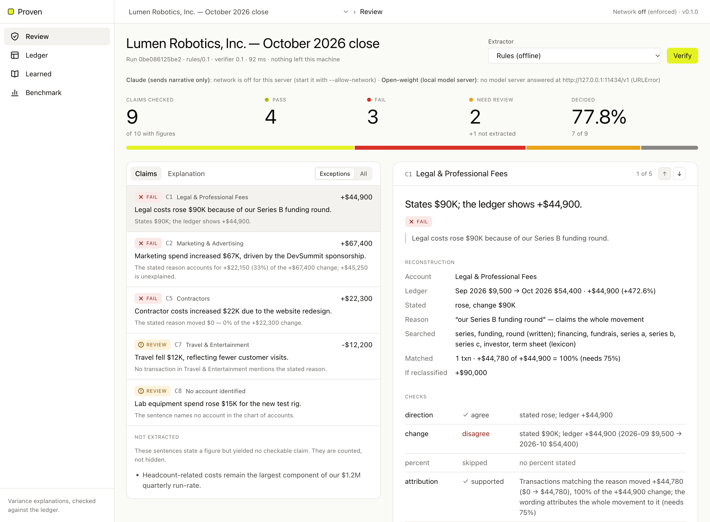
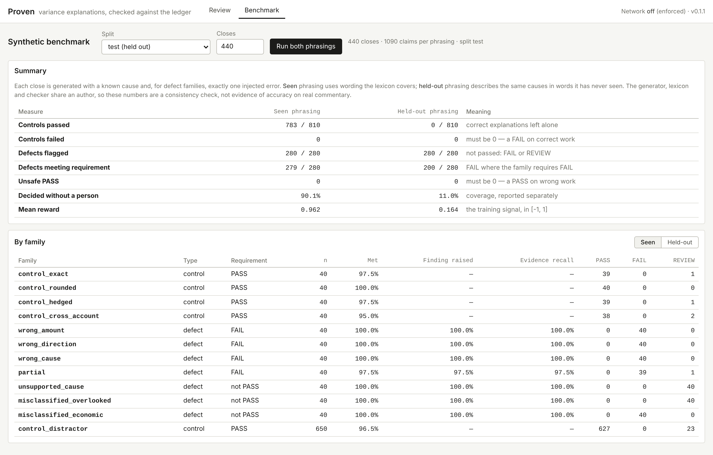

# Proven

**Checks the reasons in month-end variance explanations against the company's transactions.**

> *"Legal costs rose $90K because of our Series B funding round."*
>
> **FAIL**: Legal moved **+$44,900** as booked. A **$45,100** Harbor & Vale LLP invoice for the
> Series B (TX-2068, *"Series B — investor rights agreements"*) is booked to **Marketing**; that
> vendor books to Legal in 4 of 4 other transactions. Reclassified, Legal rose **+$90,000**, which
> agrees with the sentence. So the narrative is right, and the books are wrong.

Every month, finance teams explain why the numbers moved. AI copilots increasingly draft those
explanations, and a correct amount can come with the wrong reason. Proven reads an explanation,
finds each claim, and checks it against the general ledger: amount, direction, and whether the
stated cause actually accounts for the movement. Every flag cites the transactions behind it.

Team **Oski's Back Office** (UC Berkeley): Julien Bergeron-Palmer (data generation
infrastructure), Aarnav Bhat (ML / RL architecture), Arun Yama.

**Live demo: <https://proven-lac.vercel.app>**: opens on the demo close; nothing to install.
The [review guide](#how-to-review-on-the-website) below walks through the screen.



**Contents:** [Try it](#try-it) · [How to review on the website](#how-to-review-on-the-website) ·
[How it works](#how-it-works) · [The decisions behind it](#the-decisions-behind-it) ·
[Results](#results) · [The RL plan](#the-rl-plan-and-what-exists-today) ·
[Running and deploying](#running-and-deploying) · [Layout and API](#layout-and-api)

---

## Try it

- **Online.** Open <https://proven-lac.vercel.app>. Nothing to install; it opens on the demo close.
- **On your machine.** Python 3.10+ and nothing else: no packages, no build step, no API key.
  From the repository root:

  ```bash
  python -m proven serve
  ```

  Then open <http://127.0.0.1:8765>.

The hosted and local versions run the same checks on the same data. The differences are listed
under [Running and deploying](#running-and-deploying).

---

## How to review on the website

The console is built for one job: a reviewer deciding the exceptions in an explanation, with the
claim, the ledger evidence, the reconstruction, the verdict and the reason on one screen.

### The screen at a glance

| Area | What it shows |
|---|---|
| **Top bar** | The **Review** and **Benchmark** tabs. On the right, the network status ("Network off") and the version. |
| **Toolbar** | **Close**: which month-end close to check (the showcase, or a synthetic close). **Extractor**: how sentences are read ("Rules (offline)"; the Claude option shows as unavailable unless enabled). **Verify** re-runs the check. Beside it: the run ID, the extractor and verifier versions, the time taken, and "nothing left this machine". |
| **Explanation** (left) | The commentary being checked. Each checked sentence is underlined in its verdict's colour and tagged with its claim number (C1, C2, …). A dashed underline marks a sentence that states a figure but could not be checked. Click any underlined sentence to open its claim. |
| **Ledger** (left) | Every account's balance in the prior and current month, the change and the % change, plus a total row. The account of the claim you selected is highlighted. Above it: the company, the transaction count and the ledger's fingerprint (sha256). |
| **Coverage** (right) | **Claims checked** (out of sentences with figures), **Decided** (the share that reached PASS or FAIL without a person), **Pass · Fail**, and **Need review** (with any sentences not extracted). |
| **Claims** (right) | One card per claim. **Exceptions** (the default) shows FAIL cards first, then REVIEW; **All** adds the passes. Below the cards: sentences that were not extracted, and any proposals the extractor made that the text did not support. |

On a laptop, the left column stays in view while you scroll the claims, so the source is always
beside the claim you are reading.

### Reviewing a close, step by step

1. **Choose a close and let it run.** The page checks the selected close as soon as it loads. To
   check another, pick it under **Close**; it verifies automatically.
2. **Read Coverage before the verdicts.** It tells you how much of the explanation was actually
   checked. On the showcase: 9 claims out of 10 sentences with figures, 7 decided (77.8%),
   4 pass · 3 fail, 2 need review, and 1 sentence not extracted.
3. **Work through the exceptions.** The Claims list opens on **Exceptions**, FAILs first, with
   the first one expanded. Each card's header shows the verdict, the sentence and a one-line
   reason. Click a header to open or close it.
4. **Read an open card top to bottom.** It always has the same sections:
   - **Reconstruction**: what the sentence claimed beside what the ledger shows (row by row
     below).
   - **Checks**: each check that ran, with its outcome, and the ones that were skipped and why.
   - **Findings**: what is wrong or uncertain, with a table of the evidence transactions (ID,
     date, account, vendor, memo, amount). A transaction booked outside the claim's account is
     marked "(other account)".
   - **Largest movements in** the account: which vendors moved it, by how much.
   - **Adjustments and notes**: anything the guards changed, and anything the reading dropped.
   - **Resolve**: your decision (FAIL and REVIEW cards only).
5. **Check the evidence against the source.** The transaction IDs in a finding are real rows of
   the ledger. The highlighted row in the Ledger table is the account the claim is about.
   Clicking a sentence in the explanation jumps to its card, and clicking a PASS sentence
   switches the list to **All** so you can audit it.
6. **Record a decision.** In **Resolve**, choose what is true, write *why* (at least 10
   characters; a decision nobody can re-read cannot become a test), and press **Record**. The
   section confirms "Recorded: …". The time you spent on the claim is recorded with it.
7. **Change the inputs and re-check.** **Edit text** turns the explanation into an editable box;
   change a figure or a reason, then press **Verify** (or Ctrl/Cmd+Enter). **Show checked text**
   returns to the underlined view. **Upload CSV** checks the explanation against your own ledger
   export, **Use scenario ledger** switches back, and **Download CSV** gives you the selected
   close's ledger, which doubles as a template for the format.

### What each verdict asks of you

| Verdict | Means | What to do |
|---|---|---|
| **PASS** | Every check that ran agrees with the ledger, and at least one check ran. | Nothing. Audit a few with **All** if you like. |
| **FAIL** | The ledger contradicts the sentence: wrong amount or direction, a cause that did not move, or a cause that explains less than the wording claims. | Confirm it, or record why Proven is wrong. |
| **REVIEW** | The ledger cannot settle it: the cause was not found, the match is weak, an expense may be misbooked, or the amount is close but outside tolerance. | Look at the evidence and decide. |

Underline colours follow the verdict (green PASS, red FAIL, amber REVIEW). The verdict is always
also written out in text, so nothing relies on colour alone.

### The Reconstruction rows

| Row | Shows |
|---|---|
| **Account** | The account the sentence is about. "mapped by the model" means no alias in the sentence named it, so the claim cannot be decided without you. |
| **Ledger** | Prior balance → current balance, the change and the % change. |
| **Stated** | What the sentence claims: rose/fell, the change, a percentage, "to" a balance, "from" a balance. |
| **Reason** | The stated cause, and how much of the movement the wording claims for it: "the whole movement" (*because of*, *due to*), "most of the movement" (*primarily*) or "part of the movement" (*partly*). |
| **Searched** | The words looked for in vendor names and memos, labelled by origin: *written* (in the sentence), *lexicon* (declared synonyms) or *model* (proposed by the Claude extractor). |
| **Matched** | How many transactions matched, how much they moved, and what share of the account's change that is, against the share the wording needs (75% for *because of*, 50% for *primarily*, 10% for *partly*). |
| **If reclassified** | The account's change if the possibly misbooked expenses were moved back. |

### The Checks list

| Check | Outcomes |
|---|---|
| **direction** | *agree* / *disagree* |
| **change**, **percent**, **current**, **prior** | *agree* (within 5%, or within the precision the figure was written to) / *near* (5–10% off: REVIEW) / *disagree* (more than 10% off: FAIL) |
| **attribution** | *supported* / *partial* / *wrong cause* / *not found* / *weak match* / *model only* |
| **classification** | *clear* / *flagged* |

A check shown as *skipped* did not run, with the reason beside it: for example "no percent
stated", or a movement below the $1,000 materiality threshold.

### Finding codes

| Code | Severity | Meaning | What to look at |
|---|---|---|---|
| `WRONG_AMOUNT` | confirmed → FAIL | The stated change is more than 10% off the ledger's. | The largest movements; whether something is misbooked. |
| `WRONG_DIRECTION` | confirmed → FAIL | It says "rose" and the account fell, or the reverse. | The ledger row. |
| `WRONG_PERCENT` | confirmed → FAIL | The stated percentage change is off. | The ledger's % column. |
| `WRONG_BALANCE` | confirmed → FAIL | A stated "to"/"from" balance is off. | The ledger row. |
| `…_NEAR` | advisory → REVIEW | Any of the four above, 5–10% off: close, but outside tolerance. | Whether the rounding is acceptable. |
| `WRONG_CAUSE` | confirmed → FAIL | The cause's transactions moved less than 25% of the change (10% when the sentence says *partly*). | The evidence: the cause's flat transactions, then the real movers. |
| `PARTIAL_EXPLANATION` | confirmed → FAIL | The cause explains some, but less than the wording claims. | The unexplained movers in the evidence. |
| `REASON_NOT_FOUND` | advisory → REVIEW | No transaction mentions the stated cause. | The real movers listed; the cause may be recorded in other words. |
| `WEAK_REASON_MATCH` | advisory → REVIEW | Only part of the reason's wording matched, so the matched transactions may belong to another cause. | Whether the matched memos really are this cause. |
| `REASON_NOT_SEARCHABLE` | advisory → REVIEW | The reason contains only generic words. | The movers. |
| `SUPPORT_RESTS_ON_MODEL_TERMS` | advisory → REVIEW | The cause is supported only by words the model proposed. | Whether those transactions belong to the cause. |
| `POSSIBLE_MISCLASSIFICATION` | advisory → REVIEW | An expense of this cause sits in an account its vendor does not normally use: missing from this account, or inflating it. | The vendor's usual account; the reclassified change. |
| `ACCOUNT_NOT_FOUND` | advisory → REVIEW | The sentence names no account in the chart. | Which account is meant. |

### Resolve actions

| Action | Use when | Teaches Proven something? |
|---|---|---|
| **Confirm defect** | The explanation is wrong. This is the product working. | No: it is the value delivered. |
| **Wrong evidence** | The explanation is right; Proven matched the wrong transactions. | Yes |
| **Misread sentence** | Proven read the account, amount or reason wrongly. | Yes |
| **Accept convention** | Rounding, wording or a booking convention Proven should learn. | Yes |
| **Out of scope** | It is a judgement, not something the ledger can settle. | No, by design |
| **Missing evidence** | The ledger supplied does not contain what is needed. | No: it is a data request |

Locally, resolutions are appended to `.proven/resolutions.jsonl`. On the hosted demo they are
temporary.

### Checking Proven against an answer key

The **Close** menu also lists synthetic closes from the held-out test split, one per error type.
Each has a line under the explanation, for example:

> Ground truth (synthetic): wrong cause — must fail; culprit transactions TX-1057, TX-1046. The
> other 2 claim(s) are correct.

Check that the target claim got the required verdict, that its finding cites those transaction
IDs, and that the other claims passed.

### The Benchmark tab

It runs the full synthetic benchmark on the server: choose the **Split** (the held-out test
split by default) and the number of **Closes** (440 by default), then **Run both phrasings**.
It runs automatically the first time you open the tab and takes a few seconds.

- **Summary** compares *seen* phrasing (wording the lexicon covers) with *held-out* phrasing (the
  same causes in words it has never seen). The rows to watch are **Controls failed** and
  **Unsafe PASS**, which must both be 0. **Decided without a person** is coverage, reported
  separately on purpose.
- **By family** breaks the results down by error type. Use **Seen** / **Held-out** to switch
  phrasing. **Met** is the share meeting the family's requirement, shown in red below 90%.
  **Finding raised** is whether the expected finding appeared, and **Evidence recall** is
  whether the culprit transactions were cited.

### A three-minute walkthrough of the demo close

1. **Coverage:** 9 claims, 4 PASS, 3 FAIL, 2 REVIEW, and one sentence ("…$1.2M quarterly
   run-rate") listed as not extracted rather than hidden.
2. **Legal (FAIL):** wrong amount, and the finding below it explains why: a misbooked invoice,
   shown in the evidence as "(other account)". "If reclassified" shows +$90,000.
3. **Marketing (FAIL):** the amount is right, but DevSummit is only 33% of it. The rest is the
   same misbooked legal invoice, flagged from this side too.
4. **Contractors (FAIL):** the redesign cost $11,000 in both months, so it moved $0. The
   increase is a $22,300 mobile-app contract.
5. **Travel (REVIEW):** no transaction mentions customer visits. September's company offsite is
   shown as the actual mover; Proven does not call it wrong, because the cause may be recorded
   in other words.
6. **Edit the text:** change "$90K" to "$45K" in the Legal sentence and press **Verify**. Legal
   turns to REVIEW: the amount now matches the books, but the misbooked invoice is still flagged.
7. **Benchmark tab:** 0 unsafe PASS and 0 failed controls under both phrasings, and coverage
   falling from 90% to 11% on unseen wording, which is what the model-assisted extractor is for.

---

## How it works

```
           UNTRUSTED: may propose            │           DETERMINISTIC: decides
                                             │
 explanation ─► extractor ─► ClaimProposal ──┼─► admit() ─► bind reason ─► checks ─► PASS / FAIL / REVIEW
                rules (default)              │   quote must be verbatim      to transactions        + evidence (txn IDs)
                or Claude (opt-in)           │   figures must be in quote
                                             │   direction, strength re-read
```

**Extraction.** Each sentence becomes at most one claim:

- the account, resolved by an alias written in the sentence;
- the direction;
- the stated change, percentage or balances, each kept as written (`"$90K"` is good to ±$500);
- the stated reason;
- how much of the movement the wording attributes to that reason: *because of* means all of it,
  *primarily* means most, *partly* means some.

**Checks** (`verify.py`):

| Check | Question | Outcome |
|---|---|---|
| direction | Did it rise or fall as stated? | contradiction → FAIL |
| change / percent / balances | By the stated amount, at the precision it was written to? | >10% off → FAIL; 5–10% → REVIEW |
| attribution | Do the transactions matching the stated reason account for the movement, as much as the wording claims? | cause moved <25% (<10% for *partly*) → **FAIL wrong cause**; less than claimed → **FAIL partial explanation**; not found or weak match → REVIEW |
| classification | Is an expense matching the reason booked against its vendor's usual account, either missing from this account or inflating it? | always REVIEW (advisory) |

A vendor has a "usual account" once at least 3 of its other transactions exist and at least 80%
of them land in one account.

**Verdict algebra**, carried over unchanged from Aptio:

- any confirmed finding → **FAIL**;
- else any advisory finding → **REVIEW**;
- else if no check actually ran → **REVIEW** (an absence of findings is not a pass);
- else → **PASS**.

Every threshold lives in one `Policy` object in `verify.py`, and is recorded on each run.

---

## The decisions behind it

**1. The model proposes; the ledger decides.** Our application said the language model would
"evaluate whether the stated reasons are supported". Building it, we moved that judgement out of
the model. Whether a cause explains a movement is arithmetic over transactions: the cause's
spend moved +$22,150, which is 33% of +$67,400. A model can find the claim and suggest what the
cause might be called in a memo. It never says PASS or FAIL.

That is enforced in code, in three ways:

- the model's output schema has no verdict field;
- `admit()` rejects any quote or figure not literally in the text;
- a claim cannot pass on search terms only the model supplied, or on an account only the model
  mapped. Both cap the claim at REVIEW.

**2. Three verdicts, not two.** "Wrong" and "we could not tell" are different statements, so a
reason we cannot find is REVIEW, never FAIL. Misclassification is always advisory, because
whether a booking is wrong is an accounting judgement. FAIL is reserved for contradictions that
re-executing arithmetic establishes on its own.

**3. Compare at the precision a figure was written to.** "$90K" for a movement of $91,240 is not
an error. Aptio's verifier once flagged 34 sound financial items by forgetting this. Figures keep
their text, and the comparison uses the half-unit of the last written digit plus a declared
tolerance.

**4. Evidence is transaction IDs, chosen deliberately.** A finding that cannot say what was
claimed, what the ledger shows, and which lines prove it is just a number disagreeing with
another number. Evidence is the transactions that actually moved: a retainer billed in both
months is not cited for a change.

**5. Synthetic closes with known causes, so the right answer is known by construction.** The
generator (`synth.py`) builds a company from:

- 9 accounts and recurring vendors;
- three months of history;
- injected events;
- then the commentary, written either correctly or with exactly one defect from a declared
  family.

Labels come from the *shape of the edit*, not from re-running the checker. `seed % 5 == 0` is the
test split, and family assignment is balanced across splits.

**6. A measured guard, not a guessed one.** Our first held-out run produced **3 unsafe PASSes and
2 FAILs on correct explanations**. All five had one mechanism: a single generic word from the
stated reason ("policy", "coverage") matching a *different* cause's invoices ("the new breach
policy" bound to the D&O policy).

The fix: when some written words of the reason match nothing in scope and no declared lexicon
entry vouches for the match, the binding supports neither PASS nor FAIL, so the claim goes to
REVIEW. Measured on the 440-close test split:

| | Unsafe PASS (held-out) | Control FAIL (held-out) | Decided (seen) | Controls passed (seen) |
|---|---:|---:|---:|---:|
| before the guard | 3 | 2 | 92.7% | 810 / 810 |
| after the guard | **0** | **0** | 90.1% | 783 / 810 |

We pay 2.6 points of coverage to remove the only unsafe-PASS mechanism we observed. A PASS on
wrong work is the one error that cannot be improved after shipping.

The "before" held-out run also included two held-out phrases that broke their own definition.
The generator's self-test caught them, and they were corrected.

**7. Network off, enforced at runtime.**

- `netguard.py` refuses every non-loopback connection before a byte leaves the process. The local
  server installs it at startup, and the test suite runs under it.
- The Claude path is opt-in (`--allow-network`) and sends **only the explanation text and the
  chart of accounts**: never a transaction, vendor, memo or amount.
- Each run records what was sent: byte count, payload hash, and what was excluded.
- It uses `claude-opus-5-5` with structured output, and opts into the API's server-side refusal
  fallback (`fallbacks="default"`).

**8. Small on purpose.** About 3,200 lines of Python (much of it docstrings, the synthetic world
and the demo ledger) plus one page:

- standard library only, enforced by an AST test;
- no framework, no database, no build step;
- the console is plain JavaScript, type-checked by `tsc --strict` through JSDoc.

Each of those can be added when a real deployment needs it. None was needed to find out whether
the checks work.

**9. Built on Aptio.** Proven is a condensed, self-contained build of the Aptio verification
architecture: the three-valued verdict algebra, the propose/admit extraction boundary,
written-precision comparison, the runtime network guard, and the closed set of reviewer actions.
Aptio checks the arithmetic in AI-produced financial work; Proven applies the same discipline to
the *reasons*.

---

## Results

`python -m proven benchmark --n 440` runs the test split: 440 closes and 1,090 claims per
phrasing, in about 1.5 seconds each. The Benchmark tab runs the same thing.



| | Seen phrasing | Held-out phrasing |
|---|---:|---:|
| Correct explanations passed | 783 / 810 | 0 / 810 |
| Correct explanations **failed** (must be 0) | **0** | **0** |
| Defective explanations flagged (FAIL or REVIEW) | 280 / 280 | 280 / 280 |
| Defects meeting their family's requirement | 279 / 280 | 200 / 280 |
| **Unsafe PASS** (must be 0) | **0** | **0** |
| Decided without a person | 90.1% | 11.0% |
| Mean reward | 0.962 | 0.164 |

**What this shows.** On phrasing the lexicon covers, every defect family is caught, the culprit
transactions are cited (evidence recall ≥ 97.5% per family), and correct explanations are left
alone.

On **held-out phrasing** (the same causes described in words the checker has never seen), the
amount and direction checks still decide. Binding a reason to transactions by words alone
decides almost nothing. It degrades *safely*: everything goes to REVIEW, with zero unsafe PASSes
and zero false FAILs.

That gap is the case for the model-assisted extractor. The next section measures how much of
it a model can close.

### With a model proposing

Same 440-close test split, held-out phrasing. The Claude rows replay cached answers from one
live run of `claude-sonnet-5-5` (`--extractor claude --model claude-sonnet-5-5`). The oracle
(`--extractor oracle`) feeds the generator's own gold proposals through the checker, so it is the
ceiling for any model.

| Proposer | Guard | Decided | Mean reward | Correct passed | Correct **failed** | **Unsafe PASS** |
|---|---|---:|---:|---:|---:|---:|
| Rules | default | 11.0% | 0.164 | 0 / 810 | 0 | 0 |
| Claude Sonnet | default | 11.0% | 0.180 | 0 / 810 | 0 | 0 |
| Oracle | default | 11.0% | 0.186 | 0 / 810 | 0 | 0 |
| Claude Sonnet | `--anchor-model-terms` | 38.1% | 0.431 | 283 / 810 | 0 | **12** |
| Oracle | `--anchor-model-terms` | 60.7% | 0.690 | 542 / 810 | 0 | 0 |

Three things follow.

- **A model's terms may not fail a claim either.** Before the guard covered FAIL, the same Sonnet
  run failed 68 correct explanations, every one on model-proposed terms that caught only one of
  a cause's two invoices. Those claims now go to REVIEW (`REASON_FOUND_ONLY_BY_MODEL_TERMS`).
- **Letting model terms anchor a PASS is unsafe with a real model.** The experimental
  `--anchor-model-terms` policy is clean on gold terms and produces 12 unsafe PASSes on Sonnet's:
  six where a vague reason ("the second location") drew a term that matched a neighbouring
  cause's invoices, six where the terms covered the change and hid a misbooked transaction. It is
  off by default and should stay off.
- **A model must not be able to remove what a sentence says.** A local 7B model sometimes returned
  a claim with the stated reason left out; the claim was then checked on its amount alone, and two
  wrong explanations passed. `admit()` now keeps any reason or figure the rules can read in the
  sentence when a proposal omits it. A proposal can add to the reading, never subtract from it.
- **The route across the gap is a person, once.** In the Sonnet run 710 of the 810 correct
  explanations sit in REVIEW only because their support rests on model terms. A reviewer who
  confirms such a term teaches it to the learned lexicon (`learned.py`, "Teach Proven" in the
  console); from then on the written words bind and the ledger decides.

### What confirmed lessons buy

`python3 -m proven teach-sim` plays that reviewer. It teaches from the first 220 test closes and
measures the other 220 with the **rules alone**: no model runs at check time. A claim is taught
from only if its label says the explanation is right, it sits in REVIEW solely because its support
rests on model terms, and confirming the terms that matched transactions turns it into a PASS.
Held-out phrasing, terms proposed by Sonnet (replayed from cache):

| Closes taught from | Lessons | Decided | Reward | Controls passed | Control FAIL | Unsafe PASS |
|---|---|---|---|---|---|---|
| 0 | 0 | 11.1% | 0.165 | 0/402 | 0 | 0 |
| 10 | 12 | 39.3% | 0.446 | 136/402 | 0 | 0 |
| 20 | 22 | 60.2% | 0.653 | 242/402 | 0 | 0 |
| 55 | 34 | 84.0% | 0.895 | 357/402 | 0 | 0 |
| 110 | 36 | 88.6% | 0.942 | 380/402 | 0 | 0 |

With gold terms (the default, `--extractor oracle`, fully offline) the same loop reaches 92.6%
decided on held-out phrasing and 87.1% on the paraphrase tier after 220 closes, again with no
unsafe PASS and no control FAIL.

Read this as an upper bound, not a forecast. The simulated reviewer reads the label, so it never
confirms a wrong explanation; a person can. The synthetic phrasings come from a finite pool (a few dozen
held-out reasons), so the curve saturates far sooner than real commentary would. What it does show
is the shape of the system: the model's job is to draft lessons, a person confirms each once, and
after that the deterministic rules decide.

Local open-weight models, through Ollama on an M5 Pro, on 40 held-out closes (77 controls, 24
defects). No model run broke a kill criterion; what differs is how many usable lessons each
drafts from the same 40 closes, and what those lessons do on the next 40:

| Proposer | Decided, default guard | Control FAIL | Unsafe PASS | Lessons from 40 closes | Decided on the next 40 after teaching |
|---|---|---|---|---|---|
| llama3.1:8b | 10.9% | 0 | 0 | 1 | 10.6% |
| qwen2.5:7b | 10.9% | 0 | 0 | 4 | 17.3% |
| qwen2.5:14b | 10.9% | 0 | 0 | 7 | 22.1% |
| qwen3.5:9b (q4) | 9.9% | 0 | 0 | 7 | 24.0% |
| Claude Sonnet | 10.9% | 0 | 0 | 31 | 71.2% |

(Untaught, the next 40 closes sit at 9.6% decided. qwen3.5:9b failed to extract 3 of the 24
defective claims at all; those count as missed, not passed.) So the proposer's quality matters
after all, but as a drafter of lessons rather than as a judge: that is the place a stronger or
fine-tuned model would pay.

The first run of this simulation passed three wrong explanations. A correct lesson
("board coverage" → d&o) left the stray word "coverage" free to match an unrelated cyber-coverage
invoice, and together they covered a movement the stated reason only half explained. A lesson now
replaces its trigger's words instead of adding to them (`claims.anchored_terms`).

There is also a `paraphrase` tier (`--phrasing paraphrase`) whose train and test phrases are
disjoint from each other and from the held-out tier, and a hand-written close
(`proven/examples/`, a coffee roaster) whose answer key was committed before Proven ran on it.
No defective sentence in it passes; several correct ones go to REVIEW over one unmatched word.

**What this does not show.** The generator, the lexicon and the checker share an author, so the
seen-phrasing numbers are a **consistency check, not evidence of accuracy** on real commentary.
Other limits:

- No real company's explanations have been checked yet.
- English only.
- One claim per sentence.
- Two periods.
- Expense accounts only; no accruals or reversals logic.
- The Claude extractor has been run live once (Haiku, Sonnet and Opus on 40 closes; Sonnet on
  440). The open-weight extractor has been run on 40 closes per model, which is a small sample.

---

## The RL plan, and what exists today

The application proposed training on synthetic examples with known causes, rewarding accurate
judgements backed by the right evidence. Given decision 1, what gets trained is the **proposer**,
not a judge. Its job is reading the claim and suggesting the vocabulary a cause leaves in a
ledger. The reward is computed from the deterministic checker's outcome on its proposals.

What exists:

- **Data.** `python -m proven generate` writes labelled closes as JSON lines: ledger,
  explanation, and per-claim family, requirement, expected finding and culprit transactions.
  Train and test splits are disjoint, with seen, held-out and paraphrase phrasings. Every label
  carries a gold proposal, and `--format chat` writes chat-format fine-tuning examples.
- **Reward.** `evaluate.reward()` is in [−1, 1] and asymmetric:

  | Outcome | Reward |
  |---|---|
  | unsafe PASS | −1 |
  | FAIL on a correct explanation | −0.5 |
  | REVIEW on a correct explanation | 0 |
  | correct flag | scaled by evidence F1 against the culprit transactions |

- **Baseline and target.** The rule extractor scores 0.962 on seen phrasing and 0.164 on held-out
  phrasing. Held-out mean reward, with unsafe PASS held at zero, is the number a trained proposer
  has to move.
- **Safety by construction.** A proposer's terms alone can never turn a claim into a PASS or a
  FAIL.
- **Ceiling.** That same guard caps what training can buy: with it on, a perfect proposer
  reaches 0.186 mean reward on held-out phrasing, against 0.164 for the rules. Relaxing it is what a real
  model cannot be trusted with.

What does not exist yet: a training run. Given the ceiling, the more promising use of the
proposer is suggesting vocabulary for a reviewer to confirm.

---

## Running and deploying

### Locally

Python 3.10+, no packages. From the repository root:

```bash
python -m proven serve
```

```bash
python -m proven showcase
```

```bash
python -m proven benchmark --n 440
```

```bash
python -m proven verify --ledger my_gl_export.csv --explanation commentary.txt
```

```bash
python -m proven generate --split train --n 5000 --out train.jsonl
```

`pip install .` also installs these as a `proven` command (`proven serve`, `proven showcase`, …).

A ledger CSV needs the columns `id, date, account, vendor, memo, amount`; amounts may use
thousands separators or accounting parentheses. The two most recent months become the prior and
current periods.

Settings are read from a `.env` file if one exists (`ANTHROPIC_API_KEY`, `PROVEN_CLAUDE_MODEL`,
`PROVEN_OPENAI_BASE_URL`, `PROVEN_OPENAI_API_KEY`, `PROVEN_OPENAI_MODEL`, `PROVEN_TOKEN_BUDGET`,
`PROVEN_USD_BUDGET`); the real environment wins.

The optional Claude extractor needs `pip install anthropic` and an API key, and must be enabled
explicitly:

```bash
python -m proven serve --allow-network
python -m proven benchmark --extractor claude --model claude-sonnet-5-5 --allow-network \
    --phrasing heldout --n 40 --usd-budget 1
```

Every request is checked against a token and dollar budget before it is sent, and proposals are
cached in `.proven/cache`, so a repeated run costs nothing.

The open-weight extractor talks to any OpenAI-compatible endpoint. A local Ollama server is on
loopback, so it needs no network permission:

```bash
python -m proven benchmark --extractor openweight --model qwen2.5:14b --phrasing heldout --n 40
```

### Tests

```bash
python -m pytest proven/tests -q
```

241 tests, including negative controls (inputs that must *not* be flagged), the benchmark floors,
an AST check that the package imports nothing outside the standard library, the HTTP API, and the
Vercel entry point. If the TypeScript compiler (`tsc`) is installed, the console's script is
also type-checked under `--strict`.

### On Vercel

The live demo, <https://proven-lac.vercel.app>, is this repository deployed on Vercel; every push
to `main` redeploys it. To deploy your own copy, import the repository at
<https://vercel.com/new> and press Deploy, with no settings to change. `vercel.json` copies the
console's three static files into `public/`, where Vercel serves them from its CDN. Every
`/api/*` request goes to one Python function, `api/index.py`, which reuses the same request
handler as `python -m proven serve`.

Two things differ from running locally:

- **Resolutions are temporary.** They are written under `/tmp`, the only writable path on
  Vercel, so they last only as long as the function instance. Run locally to keep them.
- **The network guard is not installed.** Vercel's runtime talks to its host process over a
  Unix socket, which the guard would refuse; the status bar therefore says "Network off" without
  "(enforced)". The hosted demo still makes no outbound calls: the Claude extractor refuses to
  run unless the process explicitly allowed the network, and this one does not.

---

## Layout and API

```
proven/
  money.py      figures as written; written-precision comparison
  ledger.py     transactions, variance, vendor history, CSV
  claims.py     proposals, admit(), deterministic readers, the lexicon
  extract.py    the rule extractor
  llm.py        the optional Claude extractor (proposes only)
  openweight.py the optional open-weight extractor (OpenAI-compatible endpoint)
  extractors.py builds an extractor by name, with budget and cache
  budget.py     token and dollar limit, checked before every request
  cache.py      proposals cached on disk
  env.py        reads .env
  learned.py    reviewer-confirmed vocabulary
  teachsim.py   simulated reviewer loop: what confirmed lessons buy on untaught closes
  examples/     a hand-written close with its answer key
  verify.py     the checks and the verdict algebra
  report.py     one run: coverage, verdicts, evidence, run record
  synth.py      synthetic closes with known causes
  evaluate.py   the benchmark and the reward
  showcase.py   the demo close, pinned by tests
  netguard.py   network-off, enforced
  server.py     stdlib HTTP server + JSON API
  web/          the reviewer console (HTML, CSS, JS checked by tsc --strict)
  tests/        241 tests
api/index.py    the Vercel function (wraps the same request handler)
vercel.json     static console from the CDN, /api/* to the function
docs/           the screenshots in this README
```

| Method | Path | Does |
|---|---|---|
| GET | `/api/config` | versions, network status, extractors, policy, resolve actions |
| GET | `/api/scenarios` | the showcase and one held-out synthetic close per error type |
| GET | `/api/scenario?id=` | a close's ledger, explanation and (synthetic) ground truth |
| GET | `/api/ledger.csv?id=` | a close's ledger as a CSV |
| POST | `/api/verify` | explanation + scenario or CSV ledger → full report |
| POST | `/api/benchmark` | `{split, n, phrasing, extractor}` (rules or oracle) → per-family results |
| GET | `/api/lexicon` | reviewer-confirmed vocabulary |
| POST | `/api/lexicon/remove` | `{id}` → forget one lesson |
| GET, POST | `/api/resolutions` | list or record reviewer decisions |
