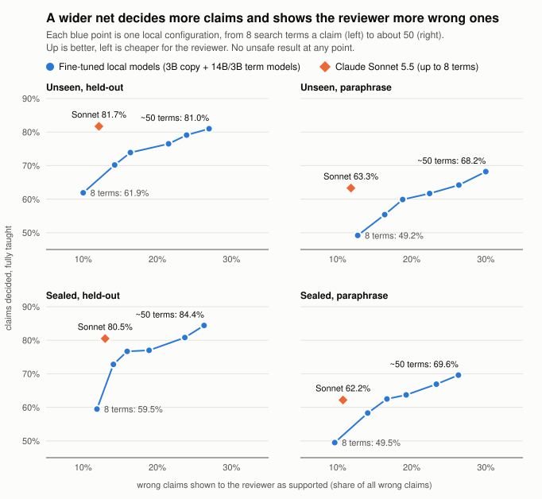

# Proven

**Checks the reasons in month-end variance explanations against the company's transactions.**

> *"Legal costs rose $90K because of our Series B funding round."*
>
> **FAIL**: Legal moved **+$44,900** as booked. A **$45,100** Harbor & Vale LLP invoice for the
> Series B (TX-2068, *"Series B — investor rights agreements"*) is booked to **Marketing**; that
> vendor books to Legal in 4 of 4 other transactions. Reclassified, Legal rose **+$90,000**, which
> agrees with the sentence. So the narrative is right, and the books are wrong.

Every month, finance teams explain why the numbers moved. AI copilots increasingly draft those
explanations, and a correct amount can come with the wrong reason. Proven reads an explanation,
finds each claim, and checks it against the general ledger: amount, direction, and whether the
stated cause actually accounts for the movement. Every flag cites the transactions behind it.

**At a glance**

- **Three verdicts per claim.** PASS when the ledger agrees, FAIL when it contradicts the
  sentence, REVIEW when the ledger cannot settle it.
- **Evidence, not opinion.** Every flag names the transactions behind it, by ID.
- **No model makes the call.** An optional language model may help read sentences; every verdict
  comes from arithmetic over the ledger.
- **Runs offline.** Python's standard library only, and the local server refuses outbound
  connections.
- **Status:** a working demo, tested on synthetic data only. See [Results](#results) for what the
  numbers do and do not show.

Team **Oski's Back Office** (UC Berkeley): Julien Bergeron-Palmer (data generation
infrastructure), Aarnav Bhat (ML / RL architecture), Arun Yama.

| | |
|---|---|
| **Live demo** | <https://proven-lac.vercel.app> (opens on the demo close; nothing to install) |
| **Demo video** | [`video/out/proven-demo-2min.mp4`](video/out/proven-demo-2min.mp4) (2 minutes) |
| **Console reference** | [`docs/review-guide.md`](docs/review-guide.md) |
| **Fine-tuning write-up** | [`docs/finetune.md`](docs/finetune.md) |


## Contents

1. [Try it](#try-it)
2. [A three-minute walkthrough](#a-three-minute-walkthrough)
3. [How it works](#how-it-works)
4. [The decisions behind it](#the-decisions-behind-it)
5. [Results](#results)
6. [Training a proposer](#training-a-proposer)
7. [Running and deploying](#running-and-deploying)
8. [Layout and API](#layout-and-api)
9. [Further reading](#further-reading)

---

## Try it

- **Online.** Open <https://proven-lac.vercel.app>. Nothing to install; it opens on the demo close.
- **On your machine.** Python 3.10+ and nothing else: no packages, no build step, no API key.
  From the repository root:

  ```bash
  python -m proven serve
  ```

  Then open <http://127.0.0.1:8765>.

The hosted and local versions run the same checks on the same data. The differences are listed
under [Running and deploying](#running-and-deploying).

---

## A three-minute walkthrough

On the demo close, in the live demo or locally:

1. **Coverage:** 9 claims, 4 PASS, 3 FAIL, 2 REVIEW, and one sentence ("…$1.2M quarterly
   run-rate") listed under the claims as not extracted rather than hidden.
2. **Legal (FAIL, C1, already selected):** wrong amount, and the finding below it explains why:
   a misbooked invoice, shown in the evidence as "(other account)". "If reclassified" shows
   +$90,000.
3. **Marketing (FAIL, C2):** click its row. The amount is right, but DevSummit is only 33% of
   it. The rest is the same misbooked legal invoice, flagged from this side too.
4. **Contractors (FAIL, C5):** the redesign cost $11,000 in both months, so it moved $0. The
   increase is a $22,300 mobile-app contract.
5. **Travel (REVIEW, C7):** no transaction mentions customer visits. September's company
   offsite is shown as the actual mover; Proven does not call it wrong, because the cause may
   be recorded in other words.
6. **Try a bad lesson:** on Travel, choose **Accept convention**, enter "offsite" as the ledger
   word and press **Check with the safety gate**. It reports the effect ("This claim: REVIEW →
   PASS") without storing anything. Record **Confirm defect** on the claim instead, check the
   same lesson again, and the answer becomes **Gate refuses**.
7. **Edit the text:** on the **Explanation** tab press **Edit text**, change "$90K" to "$45K"
   in the Legal sentence and press **Verify**. Back on **Claims**, Legal is now REVIEW: the
   amount matches the books, but the misbooked invoice is still flagged.
8. **Benchmark:** 0 unsafe PASS and 0 failed controls under all three phrasings, and coverage
   falling from 90% to 11% on unseen wording, which is what the model-assisted extractor is for.

Each claim gets one of three verdicts:

| Verdict | Means | What to do |
|---|---|---|
| **PASS** | Every check that ran agrees with the ledger, and at least one check ran. | Nothing. Audit a few with **All** if you like. |
| **FAIL** | The ledger contradicts the sentence: wrong amount or direction, a cause that did not move, or a cause that explains less than the wording claims. | Confirm it, or record why Proven is wrong. |
| **REVIEW** | The ledger cannot settle it: the cause was not found, the match is weak, an expense may be misbooked, or the amount is close but outside tolerance. | Look at the evidence and decide. |

Every part of the screen (the reconstruction rows, the checks, the finding codes, the resolve
actions, teaching and the safety gate) is described in [`docs/review-guide.md`](docs/review-guide.md).

---

## How it works

```
           UNTRUSTED: may propose            │           DETERMINISTIC: decides
                                             │
 explanation ─► extractor ─► ClaimProposal ──┼─► admit() ─► bind reason ─► checks ─► PASS / FAIL / REVIEW
                rules (default)              │   quote must be verbatim      to transactions        + evidence (txn IDs)
                or Claude (opt-in)           │   figures must be in quote
                                             │   direction, strength re-read
```

**Extraction.** Each sentence becomes at most one claim:

- the account, resolved by an alias written in the sentence;
- the direction;
- the stated change, percentage or balances, each kept as written (`"$90K"` is good to ±$500);
- the stated reason;
- how much of the movement the wording attributes to that reason: *because of* means all of it,
  *primarily* means most, *partly* means some.

**Checks** (`verify.py`):

| Check | Question | Outcome |
|---|---|---|
| direction | Did it rise or fall as stated? | contradiction → FAIL |
| change / percent / balances | By the stated amount, at the precision it was written to? | >10% off → FAIL; 5–10% → REVIEW |
| attribution | Do the transactions matching the stated reason account for the movement, as much as the wording claims? | cause moved <25% (<10% for *partly*) → **FAIL wrong cause**; less than claimed → **FAIL partial explanation**; not found or weak match → REVIEW |
| classification | Is an expense matching the reason booked against its vendor's usual account, either missing from this account or inflating it? | always REVIEW (advisory) |

A vendor has a "usual account" once at least 3 of its other transactions exist and at least 80%
of them land in one account.

**Verdict algebra:**

- any confirmed finding → **FAIL**;
- else any advisory finding → **REVIEW**;
- else if no check actually ran → **REVIEW** (an absence of findings is not a pass);
- else → **PASS**.

Every threshold lives in one `Policy` object in `verify.py`, and is recorded on each run.

---

## The decisions behind it

**1. The model proposes; the ledger decides.** Our application said the language model would
"evaluate whether the stated reasons are supported". Building it, we moved that judgement out of
the model. Whether a cause explains a movement is arithmetic over transactions: the cause's
spend moved +$22,150, which is 33% of +$67,400. A model can find the claim and suggest what the
cause might be called in a memo. It never says PASS or FAIL.

That is enforced in code, in three ways:

- the model's output schema has no verdict field;
- `admit()` rejects any quote or figure not literally in the text;
- a claim cannot pass on search terms only the model supplied, or on an account only the model
  mapped. Both cap the claim at REVIEW.

**2. Three verdicts, not two.** "Wrong" and "we could not tell" are different statements, so a
reason we cannot find is REVIEW, never FAIL. Misclassification is always advisory, because
whether a booking is wrong is an accounting judgement. FAIL is reserved for contradictions that
re-executing arithmetic establishes on its own.

**3. Compare at the precision a figure was written to.** "$90K" for a movement of $91,240 is not
an error, and a checker that flags it is worse than no checker. Figures keep their text, and the
comparison uses the half-unit of the last written digit plus a declared tolerance.

**4. Evidence is transaction IDs, chosen deliberately.** A finding that cannot say what was
claimed, what the ledger shows, and which lines prove it is just a number disagreeing with
another number. Evidence is the transactions that actually moved: a retainer billed in both
months is not cited for a change.

**5. Synthetic closes with known causes, so the right answer is known by construction.** The
generator (`synth.py`) builds a company from:

- 9 accounts and recurring vendors;
- three months of history;
- injected events;
- then the commentary, written either correctly or with exactly one defect from a declared
  family.

Labels come from the *shape of the edit*, not from re-running the checker. `seed % 5 == 0` is the
test split, and family assignment is balanced across splits.

**6. A measured guard, not a guessed one.** Our first held-out run produced **3 unsafe PASSes and
2 FAILs on correct explanations**. All five had one mechanism: a single generic word from the
stated reason ("policy", "coverage") matching a *different* cause's invoices ("the new breach
policy" bound to the D&O policy).

The fix: when some written words of the reason match nothing in scope and no declared lexicon
entry vouches for the match, the binding supports neither PASS nor FAIL, so the claim goes to
REVIEW. Measured on the 440-close test split:

| | Unsafe PASS (held-out) | Control FAIL (held-out) | Decided (seen) | Controls passed (seen) |
|---|---:|---:|---:|---:|
| before the guard | 3 | 2 | 92.7% | 810 / 810 |
| after the guard | **0** | **0** | 90.1% | 783 / 810 |

We pay 2.6 points of coverage to remove the only unsafe-PASS mechanism we observed. A PASS on
wrong work is the one error that cannot be improved after shipping.

The "before" held-out run also included two held-out phrases that broke their own definition.
The generator's self-test caught them, and they were corrected.

**7. Network off, enforced at runtime.**

- `netguard.py` refuses every non-loopback connection before a byte leaves the process. The local
  server installs it at startup, and the test suite runs under it.
- The Claude path is opt-in (`--allow-network`) and sends **only the explanation text and the
  chart of accounts**: never a transaction, vendor, memo or amount.
- Each run records what was sent: byte count, payload hash, and what was excluded.
- It uses `claude-opus-5-5` with structured output, and opts into the API's server-side refusal
  fallback (`fallbacks="default"`).

**8. Small on purpose.** About 3,200 lines of Python (much of it docstrings, the synthetic world
and the demo ledger) plus one page:

- standard library only, enforced by an AST test;
- no framework, no database, no build step;
- the console is plain JavaScript, type-checked by `tsc --strict` through JSDoc.

Each of those can be added when a real deployment needs it. None was needed to find out whether
the checks work.

---

## Results

`python -m proven benchmark --n 440` runs the test split: 440 closes and 1,090 claims per
phrasing, in about 1.5 seconds each. The Benchmark tab runs the same thing.


| | Seen phrasing | Held-out phrasing |
|---|---:|---:|
| Correct explanations passed | 783 / 810 | 0 / 810 |
| Correct explanations **failed** (must be 0) | **0** | **0** |
| Defective explanations flagged (FAIL or REVIEW) | 280 / 280 | 280 / 280 |
| Defects meeting their family's requirement | 279 / 280 | 200 / 280 |
| **Unsafe PASS** (must be 0) | **0** | **0** |
| Decided without a person | 90.1% | 11.0% |
| Mean reward | 0.962 | 0.164 |

**What this shows.** On phrasing the lexicon covers, every defect family is caught, the culprit
transactions are cited (evidence recall ≥ 97.5% per family), and correct explanations are left
alone.

On **held-out phrasing** (the same causes described in words the checker has never seen), the
amount and direction checks still decide. Binding a reason to transactions by words alone
decides almost nothing. It degrades *safely*: everything goes to REVIEW, with zero unsafe PASSes
and zero false FAILs.

That gap is the case for the model-assisted extractor. The next two tables measure how much of
it a model can close.

### With a model drafting lessons

A model's search terms alone can never turn a claim into a PASS or a FAIL: such a claim waits in
REVIEW until a reviewer confirms the terms once, as a lesson. From then on the written rules
bind those words, and no model runs at check time.

`python3 -m proven teach-sim` plays that reviewer. It teaches from the first 220 test closes and
measures the other 220 with the **rules alone**: no model runs at check time. A claim is taught
from only if its label says the explanation is right, it sits in REVIEW solely because its support
rests on model terms, and confirming the terms that matched transactions turns it into a PASS.
Held-out phrasing, terms proposed by Sonnet (replayed from cache):

| Closes taught from | Lessons | Decided | Reward | Controls passed | Control FAIL | Unsafe PASS |
|---|---|---|---|---|---|---|
| 0 | 0 | 11.1% | 0.165 | 0/402 | 0 | 0 |
| 10 | 12 | 38.9% | 0.447 | 136/402 | 0 | 0 |
| 20 | 22 | 59.8% | 0.654 | 242/402 | 0 | 0 |
| 55 | 34 | 83.6% | 0.896 | 357/402 | 0 | 0 |
| 110 | 36 | 88.2% | 0.943 | 380/402 | 0 | 0 |

With gold terms (the default, `--extractor oracle`, fully offline) the same loop reaches 92.6%
decided on held-out phrasing and 87.1% on the paraphrase tier after 220 closes, again with no
unsafe PASS and no control FAIL.

Read this as an upper bound, not a forecast. The simulated reviewer reads the label, so it never
confirms a wrong explanation; a person can. The synthetic phrasings come from a finite pool (a few dozen
held-out reasons), so the curve saturates far sooner than real commentary would. What it does show
is the shape of the system: the model's job is to draft lessons, a person confirms each once, and
after that the deterministic rules decide.

The runs behind this (a model proposing with and without the guard, untuned local models
through Ollama, and the incidents that tightened the lesson rules) are in
[`docs/results.md`](docs/results.md).

### On companies it has never seen

The same loop on worlds no proposer was built around: new industries, each with its own chart,
vendors and memo wording, written by a different model from the training worlds, with the
protocol fixed before any model was scored. Held-out phrasing, 50 closes taught from and 50
measured per world:

| Suite | Proposer | Decided | Control FAIL | Unsafe PASS |
|---|---|---:|---:|---:|
| Unseen (11 worlds) | Oracle (ceiling) | 89.3% | 0 | 0 |
| Unseen (11 worlds) | Claude Sonnet 5.5 | 81.7% | 0 | 0 |
| Unseen (11 worlds) | Two fine-tuned Qwen2.5-3B models, wide pool | 69.4% | 0 | 0 |
| Unseen (11 worlds) | Fine-tuned 3B + 14B term models, widest pool | 81.0% | 0 | 0 |
| Sealed (9 worlds) | Claude Sonnet 5.5 | 80.5% | 0 | 0 |
| Sealed (9 worlds) | Two fine-tuned Qwen2.5-3B models, wide pool | 75.1% | 0 | 0 |
| Sealed (9 worlds) | Fine-tuned 3B + 14B term models, widest pool | **84.4%** | 0 | 0 |
| Audit (pre-registered) | Claude Sonnet 5.5 | 78.5% | 0 of 1,193 | 0 of 429 |

The local rows send about 26 and about 50 search terms a claim where Sonnet sends up to 8, and
show a reviewer more wrong claims to turn down (about 2.3 times Sonnet's for the widest pool).
On the harder paraphrase tier the widest pool decides 68.2% and 69.6% against Sonnet's 63.3%
and 62.2%. It is not a like-for-like win: cut to Sonnet's 8 terms and Sonnet's reviewer cost,
the same three-model vote decides 69.2% and 71.4%, 9 to 12 points behind
([`docs/finetune.md`](docs/finetune.md), sections 8a to 8c).



The audit suite was run once, with the checker frozen beforehand. Zero unsafe PASS in 429 wrong
explanations bounds the true rate at 0.70% with 95% confidence, counting claims; counting
worlds, the bound is 20.6%. Details and every other row are in
[`docs/finetune.md`](docs/finetune.md).

**What this does not show.** The generator, the lexicon and the checker share an author, so the
seen-phrasing numbers are a **consistency check, not evidence of accuracy** on real commentary.
Other limits:

- No real company's explanations have been checked yet.
- English only.
- One claim per sentence.
- Two periods.
- Expense accounts only; no accruals or reversals logic.
- Every world is synthetic, and the simulated reviewer reads the answer key, so every
  "decided" figure is an upper bound on a careful person.
- No run was repeated, so no variance is known.

---

## Training a proposer

The application proposed training on synthetic examples with known causes, rewarding accurate
judgements backed by the right evidence. Given decision 1, what gets trained is the **proposer**,
not a judge. Its job is reading the claim and suggesting the vocabulary a cause leaves in a
ledger. The reward is computed from the deterministic checker's outcome on its proposals.

What exists:

- **Data.** `python -m proven generate` writes labelled closes as JSON lines: ledger,
  explanation, and per-claim family, requirement, expected finding and culprit transactions.
  Train and test splits are disjoint, with seen, held-out and paraphrase phrasings. Every label
  carries a gold proposal, and `--format chat` writes chat-format fine-tuning examples.
- **Reward.** `evaluate.reward()` is in [−1, 1] and asymmetric:

  | Outcome | Reward |
  |---|---|
  | unsafe PASS | −1 |
  | FAIL on a correct explanation | −0.5 |
  | REVIEW on a correct explanation | 0 |
  | correct flag | scaled by evidence F1 against the culprit transactions |

- **Baseline and target.** The rule extractor scores 0.962 on seen phrasing and 0.164 on held-out
  phrasing. Held-out mean reward, with unsafe PASS held at zero, is the number a trained proposer
  has to move.
- **Safety by construction.** A proposer's terms alone can never turn a claim into a PASS or a
  FAIL.
- **Ceiling.** That same guard caps what training can buy: with it on, a perfect proposer
  reaches 0.186 mean reward on held-out phrasing, against 0.164 for the rules. Relaxing it is what a real
  model cannot be trusted with.

Given the ceiling, the useful job for a trained proposer is drafting vocabulary for a
reviewer to confirm, and that is what was trained and measured.

### What was trained, and what it showed

The full account, with every table and the commands, is in
[`docs/finetune.md`](docs/finetune.md). In short:

- **A small local model does not beat the hosted one on companies it has not seen.** A 3B
  open-weight model (Qwen2.5-3B, 4-bit, LoRA adapters, trained with `mlx-lm` on a 24 GB laptop)
  was fine-tuned as the proposer. On eleven "unseen" worlds (new industries, written by a
  different model from the 91 training worlds, protocol fixed before any model was scored) its
  lessons leave 54.4% of held claims decided on held-out phrasing (61.3% when four sampled
  replies are pooled). Claude Sonnet's leave 81.7%,
  and the ceiling is 89.3%. It loses in all eleven worlds. Control FAIL and unsafe PASS are 0
  for every proposer.
- **Two small models and a wider net get closer, at a cost.** A second 3B adapter trained
  only to guess search terms, pooled over four samples with the first model's terms (about
  26 terms a claim where the prompt asks for 3 to 8), decides 69.4% on the unseen suite and
  75.1% on the sealed one, against Sonnet's 81.7% and 80.5%. It shows a reviewer about half
  again as many wrong claims marked "supported" as Sonnet does, and a fixed list of 60 common
  words with no model at all decides 59.3% on the dev worlds, so part of that score is the
  net and not the model.
- **14B term models and a much wider net pass Sonnet on three of four measured tiers.** With
  the term guesser trained on Qwen2.5-14B and three term models pooled (about 50 terms a
  claim), the local proposer decides 81.0% and 68.2% on the unseen suite and 84.4% and 69.6%
  on the sealed one; Sonnet decides 81.7%, 63.3%, 80.5% and 62.2%. No control FAIL, no unsafe
  PASS. The reviewer is shown about 2.3 times as many wrong claims as with Sonnet, and Sonnet
  was not given the wider net. Cut to Sonnet's 8 terms and Sonnet's reviewer cost the same vote
  decides 69.2%, 53.9%, 71.4% and 58.6%, 4 to 12 points behind. A result about breadth on a
  laptop, not a like-for-like win.
- **In the one world it was first trained on it scores at the ceiling, by memorising.** 92.5%
  against Sonnet's 88.3%, and an ablation with four cause families removed shows the model
  had learned which words go with which of that world's causes. On the unseen worlds that
  model decides 20.9%. The unseen-worlds benchmark exists because of the ablation.
- **The loss was diagnosed to one measurable thing.** A proposer has to guess, blind, a word
  the books really use. Sonnet's guesses find the cause for 84% of true claims; the first
  multi-world model's found 33%, because its training targets named vendors no request
  predicts. Targets rebuilt as "guessable and true" doubled its rate on the dev worlds. An
  untuned 3B model finds 3% and an untuned 7B model 33%: what is left is knowledge of how
  businesses describe what they buy, which is what a larger model has.
- **The benchmark found two safety gaps in Proven.** On a second suite of nine worlds kept
  unopened (where the local model again loses, 57.8% to Sonnet's 80.5%), lessons drafted from
  Sonnet's guesses let 2 wrong explanations PASS, and lessons drafted from the local model's
  failed 2 correct ones and passed 1 wrong one. A lesson now keeps only the words its PASS
  needs, none that matched only routine lines, and must cover all of a vendor's new charges
  or none ([`docs/teaching.md`](docs/teaching.md)). With those rules no cached proposer
  breaks a kill criterion at any teaching step, and the bars moved by under a point. The
  rules were written from the breaches found, so that is a fit, not a proof.
- **Replies are admissible by construction.** `training/constrain.py` decodes under a
  byte-level automaton, so a reply is always the schema's JSON, quotes and figures are always
  substrings of the explanation, and accounts always come from the chart, at 0.73 ms per
  decoding step. Search terms stay free, because constraining them to the ledger would leak
  the answer.
- **Reinforcement learning** against the checker's reward (`training/rl.py`, RLOO) runs on
  multi-world episodes. A 20-step run changed nothing measurable. No RL result is claimed.

What does not exist yet: a local proposer that matches the hosted one at the same cost to the
reviewer, and any measurement on a real company's books.

---

## Running and deploying

### Locally

Python 3.10+, no packages. From the repository root:

```bash
python -m proven serve
```

```bash
python -m proven showcase
```

```bash
python -m proven benchmark --n 440
```

```bash
python -m proven verify --ledger my_gl_export.csv --explanation commentary.txt
```

```bash
python -m proven generate --split train --n 5000 --out train.jsonl
```

`pip install .` also installs these as a `proven` command (`proven serve`, `proven showcase`, …),
and `--version` prints the installed version.

A ledger CSV needs the columns `id, date, account, vendor, memo, amount`; amounts may use
thousands separators or accounting parentheses. The two most recent months become the prior and
current periods.

Settings are read from a `.env` file if one exists (`ANTHROPIC_API_KEY`, `PROVEN_CLAUDE_MODEL`,
`PROVEN_OPENAI_BASE_URL`, `PROVEN_OPENAI_API_KEY`, `PROVEN_OPENAI_MODEL`, `PROVEN_TOKEN_BUDGET`,
`PROVEN_USD_BUDGET`); the real environment wins.

The optional Claude extractor needs `pip install anthropic` and an API key, and must be enabled
explicitly:

```bash
python -m proven serve --allow-network
python -m proven benchmark --extractor claude --model claude-sonnet-5-5 --allow-network \
    --phrasing heldout --n 40 --usd-budget 1
```

Every request is checked against a token and dollar budget before it is sent, and proposals are
cached in `.proven/cache`, so a repeated run costs nothing.

The open-weight extractor talks to any OpenAI-compatible endpoint. A local Ollama server is on
loopback, so it needs no network permission:

```bash
python -m proven benchmark --extractor openweight --model qwen2.5:14b --phrasing heldout --n 40
```

### Tests

```bash
python -m pytest proven/tests -q
```

425 tests (424 pass, 1 skipped): 370 for the checker in `proven/tests` and 55 for the training tools in `training/`. They include negative controls (inputs that must *not* be
flagged), the benchmark floors, an AST check that the package imports nothing outside the
standard library, the HTTP API, and the Vercel entry point. If the TypeScript compiler (`tsc`) is installed, the console's script is
also type-checked under `--strict`.

### Changing the checks

- Every new check needs a negative control: a correct explanation it must *not* flag. A check
  that flags sound work costs more than it catches.
- Re-run `python -m proven benchmark` and report the seen and held-out columns separately.
  Unsafe PASS and failed controls must stay at 0; coverage is reported on its own, never folded
  into a single score.
- Thresholds live in `Policy` (`proven/verify.py`). Change them there, not in the checks.

### On Vercel

The live demo, <https://proven-lac.vercel.app>, is this repository deployed on Vercel; every push
to `main` redeploys it. To deploy your own copy, import the repository at
<https://vercel.com/new> and press Deploy, with no settings to change. `vercel.json` copies the
console's three static files into `public/`, where Vercel serves them from its CDN. Every
`/api/*` request goes to one Python function, `api/index.py`, which reuses the same request
handler as `python -m proven serve`.

Two things differ from running locally:

- **Resolutions are temporary.** They are written under `/tmp`, the only writable path on
  Vercel, so they last only as long as the function instance. Run locally to keep them.
- **The network guard is not installed.** Vercel's runtime talks to its host process over a
  Unix socket, which the guard would refuse; the status bar therefore says "Network off" without
  "(enforced)". The hosted demo still makes no outbound calls: the Claude extractor refuses to
  run unless the process explicitly allowed the network, and this one does not.

---

## Layout and API

```
proven/
  money.py      figures as written; written-precision comparison
  ledger.py     transactions, variance, vendor history, CSV
  claims.py     proposals, admit(), deterministic readers, the lexicon
  extract.py    the rule extractor
  llm.py        the optional Claude extractor (proposes only)
  openweight.py the optional open-weight extractor (OpenAI-compatible endpoint)
  extractors.py builds an extractor by name, with budget and cache
  budget.py     token and dollar limit, checked before every request
  cache.py      proposals cached on disk
  env.py        reads .env
  learned.py    reviewer-confirmed vocabulary
  teachsim.py   simulated reviewer loop: what confirmed lessons buy on untaught closes
  examples/     a hand-written close with its answer key
  verify.py     the checks and the verdict algebra
  report.py     one run: coverage, verdicts, evidence, run record
  synth.py      synthetic closes with known causes
  evaluate.py   the benchmark and the reward
  showcase.py   the demo close, pinned by tests
  netguard.py   network-off, enforced
  server.py     stdlib HTTP server + JSON API
  web/          the reviewer console (HTML, CSS, JS checked by tsc --strict)
  tests/        370 tests
api/index.py    the Vercel function (wraps the same request handler)
vercel.json     static console from the CDN, /api/* to the function
training/       fine-tuning tools: datasets, world authoring, constrained decoding, RL, 60 tests
video/          the demo video: Remotion source, script and the final cut
docs/           write-ups and the screenshots in this README
```

| Method | Path | Does |
|---|---|---|
| GET | `/api/config` | versions, network status, extractors, policy, resolve actions |
| GET | `/api/scenarios` | the showcase and one held-out synthetic close per error type |
| GET | `/api/scenario?id=` | a close's ledger, explanation and (synthetic) ground truth |
| GET | `/api/ledger.csv?id=` | a close's ledger as a CSV |
| POST | `/api/verify` | explanation + scenario or CSV ledger → full report |
| POST | `/api/benchmark` | `{split, n, phrasing, extractor}` (rules or oracle) → per-family results |
| GET | `/api/lexicon` | reviewer-confirmed vocabulary |
| POST | `/api/lexicon/remove` | `{id}` → forget one lesson |
| GET, POST | `/api/resolutions` | list or record reviewer decisions |

---

## Further reading

| Document | What it covers |
|---|---|
| [`docs/review-guide.md`](docs/review-guide.md) | Every part of the review console, with the finding codes and resolve actions |
| [`docs/results.md`](docs/results.md) | A model proposing with and without the guard; untuned local models |
| [`docs/teaching.md`](docs/teaching.md) | Lessons, the safety gate, and the incidents behind each lesson rule |
| [`docs/finetune.md`](docs/finetune.md) | Fine-tuning a local proposer: data, the unseen-worlds benchmark, results, failures and limits |
| [`docs/redteam.md`](docs/redteam.md) | Wrong explanations reworded by hand and by a fuzzer until they pass: what was fixed and what is open |
| [`docs/independent.md`](docs/independent.md) | Eight hand-designed companies written blind to the checker's code, scored against an answer key |
| [`training/README.md`](training/README.md) | How to reproduce the training runs |
| [`video/README.md`](video/README.md) | How the demo video is built |
