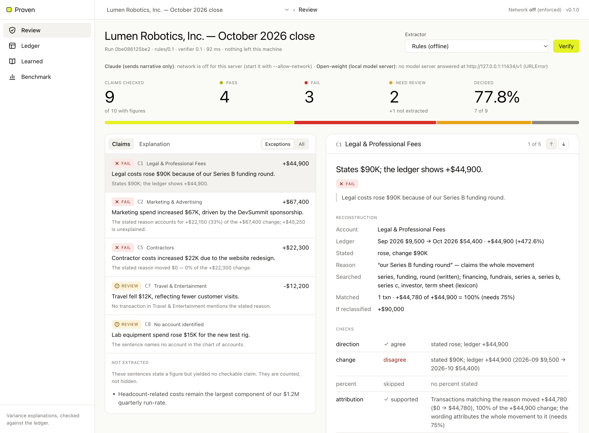

# Reviewing a close in the console

A reference for every part of the review console. The short version is the
[three-minute walkthrough](../README.md#a-three-minute-walkthrough) in the README.

The console is built for one job: a reviewer deciding the exceptions in an explanation, with the
claim, the ledger evidence, the reconstruction, the verdict and the reason on one screen.

## The screen at a glance

| Area | What it shows |
|---|---|
| **Sidebar** | The four sections: **Review**, **Ledger**, **Learned** (with the number of active lessons) and **Benchmark**. |
| **Top bar** | The **Close** menu: which month-end close to check (the showcase, a hand-written example with an answer key, or a synthetic close), then the section you are in. On the right, the network status ("Network off") and the version. |
| **Review header** | The close's name and, under it, the run ID, the extractor and verifier versions, the time taken, and "nothing left this machine". On the right, **Extractor**: how sentences are read ("Rules (offline)"; the Claude and open-weight options show as unavailable unless enabled, with the reason on the line below). **Verify** re-runs the check. |
| **Coverage** | **Claims checked** (out of sentences with figures), **Pass**, **Fail**, **Need review** (with any sentences not extracted) and **Decided** (the share that reached PASS or FAIL without a person). The bar beneath shows the same counts as proportions. |
| **Claims list** (left card) | One row per claim: verdict, claim number (C1, C2, …), account, the ledger's change, the sentence and a one-line reason. **Exceptions** (the default) shows FAIL rows first, then REVIEW; **All** adds the passes. Below the rows: sentences that were not extracted, and any proposals the extractor made that the text did not support. |
| **Explanation** (tab of the left card) | The commentary being checked. Each checked sentence is underlined in its verdict's colour and tagged with its claim number. A dashed underline marks a sentence that states a figure but could not be checked. Click any underlined sentence to select its claim. |
| **Claim detail** (right card) | The working for the selected claim: the reason, the verdict, the sentence, then Reconstruction, Checks, Findings, the largest movements and Resolve. The arrows in its header step to the previous and next claim. |
| **Ledger** (its own section) | Every account's balance in the prior and current month, the change and the % change, plus a total row. The account of the claim you selected is highlighted. Above it: the company, the transaction count and the ledger's fingerprint (sha256), with **Download CSV** and **Upload CSV**. |
| **Learned** (its own section) | **Teach next**, the queue of lessons waiting for a confirmation, and **Lessons**, the vocabulary already taught. |

On a laptop, the claim detail stays in view while you scroll the list, so the working is always
beside the claim you picked.

## Reviewing a close, step by step

1. **Choose a close and let it run.** The page checks the selected close as soon as it loads. To
   check another, pick it in the **Close** menu in the top bar; it verifies automatically.
2. **Read Coverage before the verdicts.** It tells you how much of the explanation was actually
   checked. On the showcase: 9 claims out of 10 sentences with figures, 4 pass, 3 fail,
   2 need review, 1 sentence not extracted, and 77.8% decided (7 of 9).
3. **Work through the exceptions.** The Claims list opens on **Exceptions**, FAILs first, with
   the first one selected and its working shown in the claim detail. Each row shows the
   verdict, the account, the sentence and a one-line reason. Click a row to select it, or use
   the arrows in the detail header ("1 of 5").
4. **Read the claim detail top to bottom.** Under the reason, the verdict and the quoted
   sentence, it always has the same sections:
   - **Reconstruction**: what the sentence claimed beside what the ledger shows (row by row
     below).
   - **Checks**: each check that ran, with its outcome, and the ones that were skipped and why.
   - **Findings**: what is wrong or uncertain, with a table of the evidence transactions (ID,
     date, account, vendor, memo, amount). A transaction booked outside the claim's account is
     marked "(other account)".
   - **Largest movements in** the account: which vendors moved it, by how much.
   - **Adjustments and notes**: anything the guards changed, and anything the reading dropped.
   - **Resolve**: your decision (FAIL and REVIEW cards only).
5. **Check the evidence against the source.** The transaction IDs in a finding are real rows of
   the ledger. The **Ledger** section shows every account, with the row of the selected claim's
   account highlighted. The **Explanation** tab shows the sentence in context: clicking an
   underlined sentence selects its claim, and clicking a PASS sentence switches the list to
   **All** so you can audit it.
6. **Record a decision.** In **Resolve**, choose what is true, write *why* (at least 10
   characters; a decision nobody can re-read cannot become a test), and press **Record**. The
   section confirms "Recorded: …". The time you spent on the claim is recorded with it.
7. **Change the inputs and re-check.** On the **Explanation** tab, **Edit text** turns the
   explanation into an editable box; change a figure or a reason, then press **Verify** (or
   Ctrl/Cmd+Enter). **Show checked text** returns to the underlined view without re-checking.
   In the **Ledger** section, **Upload CSV** checks the explanation against your own ledger
   export, **Use scenario ledger** switches back, and **Download CSV** gives you the selected
   close's ledger, which doubles as a template for the format.

## What each verdict asks of you

| Verdict | Means | What to do |
|---|---|---|
| **PASS** | Every check that ran agrees with the ledger, and at least one check ran. | Nothing. Audit a few with **All** if you like. |
| **FAIL** | The ledger contradicts the sentence: wrong amount or direction, a cause that did not move, or a cause that explains less than the wording claims. | Confirm it, or record why Proven is wrong. |
| **REVIEW** | The ledger cannot settle it: the cause was not found, the match is weak, an expense may be misbooked, or the amount is close but outside tolerance. | Look at the evidence and decide. |

Underline colours follow the verdict (lime green PASS, red FAIL, amber REVIEW). The verdict is
always also written out in text, so nothing relies on colour alone.

## The Reconstruction rows

| Row | Shows |
|---|---|
| **Account** | The account the sentence is about. "mapped by the model" means no alias in the sentence named it, so the claim cannot be decided without you. |
| **Ledger** | Prior balance → current balance, the change and the % change. |
| **Stated** | What the sentence claims: rose/fell, the change, a percentage, "to" a balance, "from" a balance. |
| **Reason** | The stated cause, and how much of the movement the wording claims for it: "the whole movement" (*because of*, *due to*), "most of the movement" (*primarily*) or "part of the movement" (*partly*). |
| **Searched** | The words looked for in vendor names and memos, labelled by origin: *written* (in the sentence), *lexicon* (declared synonyms), *learned* (a lesson a reviewer confirmed) or *model* (proposed by a model extractor). |
| **Matched** | How many transactions matched, how much they moved, and what share of the account's change that is, against the share the wording needs (75% for *because of*, 50% for *primarily*, 10% for *partly*). |
| **If reclassified** | The account's change if the possibly misbooked expenses were moved back. |

## The Checks list

| Check | Outcomes |
|---|---|
| **direction** | *agree* / *disagree* |
| **change**, **percent**, **current**, **prior** | *agree* (within 5%, or within the precision the figure was written to) / *near* (5–10% off: REVIEW) / *disagree* (more than 10% off: FAIL) |
| **attribution** | *supported* / *partial* / *wrong cause* / *not found* / *weak match* / *model only* |
| **classification** | *clear* / *flagged* |

A check shown as *skipped* did not run, with the reason beside it: for example "no percent
stated", or a movement below the $1,000 materiality threshold.

## Finding codes

| Code | Severity | Meaning | What to look at |
|---|---|---|---|
| `WRONG_AMOUNT` | confirmed → FAIL | The stated change is more than 10% off the ledger's. | The largest movements; whether something is misbooked. |
| `WRONG_DIRECTION` | confirmed → FAIL | It says "rose" and the account fell, or the reverse. | The ledger row. |
| `WRONG_PERCENT` | confirmed → FAIL | The stated percentage change is off. | The ledger's % column. |
| `WRONG_BALANCE` | confirmed → FAIL | A stated "to"/"from" balance is off. | The ledger row. |
| `…_NEAR` | advisory → REVIEW | Any of the four above, 5–10% off: close, but outside tolerance. | Whether the rounding is acceptable. |
| `WRONG_CAUSE` | confirmed → FAIL | The cause's transactions moved less than 25% of the change (10% when the sentence says *partly*). | The evidence: the cause's flat transactions, then the real movers. |
| `PARTIAL_EXPLANATION` | confirmed → FAIL | The cause explains some, but less than the wording claims. | The unexplained movers in the evidence. |
| `REASON_NOT_FOUND` | advisory → REVIEW | No transaction mentions the stated cause. | The real movers listed; the cause may be recorded in other words. |
| `WEAK_REASON_MATCH` | advisory → REVIEW | Only part of the reason's wording matched, so the matched transactions may belong to another cause. | Whether the matched memos really are this cause. |
| `REASON_NOT_SEARCHABLE` | advisory → REVIEW | The reason contains only generic words. | The movers. |
| `SUPPORT_RESTS_ON_MODEL_TERMS` | advisory → REVIEW | The cause is supported only by words the model proposed. | Whether those transactions belong to the cause. |
| `POSSIBLE_MISCLASSIFICATION` | advisory → REVIEW | An expense of this cause sits in an account its vendor does not normally use: missing from this account, or inflating it. | The vendor's usual account; the reclassified change. |
| `ACCOUNT_NOT_FOUND` | advisory → REVIEW | The sentence names no account in the chart. | Which account is meant. |

## Resolve actions

| Action | Use when | Teaches Proven something? |
|---|---|---|
| **Confirm defect** | The explanation is wrong. This is the product working. | No: it is the value delivered. |
| **Wrong evidence** | The explanation is right; Proven matched the wrong transactions. | Yes |
| **Misread sentence** | Proven read the account, amount or reason wrongly. | Yes |
| **Accept convention** | Rounding, wording or a booking convention Proven should learn. | Yes |
| **Out of scope** | It is a judgement, not something the ledger can settle. | No, by design |
| **Missing evidence** | The ledger supplied does not contain what is needed. | No: it is a data request |

Locally, resolutions are appended to `.proven/resolutions.jsonl`. On the hosted demo they are
temporary.

## Teaching Proven, and the lesson check

Choosing one of the three teaching actions on a claim with a stated reason opens **Teach
Proven** under the Resolve menu. A lesson is a phrase and the ledger words it stands for:
"When the stated reason says" (filled in with the claim's reason) and "search the ledger for"
(your words, comma separated). Leave the words empty to record the decision without teaching.

- **Check before you confirm.** **Check with the safety gate** replays the lesson against
  explanations known to be wrong or right, and stores nothing. The answer is in words:
  **Gate: safe** (with how many known claims it replayed), **Gate refuses** (with an example
  sentence that would wrongly pass or fail) or **Not tested** (nothing known uses the phrase,
  so check the transactions yourself). It ends with the effect here: "This claim: REVIEW →
  PASS".
- **Record.** The same check runs again when you press **Record**; a refused lesson is not
  stored, and the refusal appears in the form. A lesson that turns the claim into a PASS also
  needs the tick box confirming you checked the matched transactions. A sentence you recorded
  as **Confirm defect** becomes a known-wrong case: no later lesson may make it pass. A lesson
  is also refused when one of its words matches only this account's routine, unmoved lines or
  is not needed for the claim to pass, and when its words cover only some of a vendor's new
  charges that month; the refusal names the words
  ([why](teaching.md#lessons-keep-only-the-words-their-cause-needs)).
- **Lessons.** **Learned → Lessons** lists what was taught, with the sentence it came from and
  **Remove**. A lesson applies to every close until it is removed.
- **Teach next.** When a model extractor's words are the only support for a claim's reason, the
  claim waits in REVIEW and its run is stored. **Learned → Teach next** groups these pending
  claims by the lesson that would settle them, the one reaching the most waiting claims first.
  Each row shows the phrase and proposed words, how many claims wait, how many the rules would
  then decide, and the gate's verdict. **Open** loads the run into Review with the Teach form
  filled in; it does not confirm anything. With the Rules extractor alone the queue is empty
  ("Nothing waits yet.").

Locally, lessons are kept in `.proven/lexicon.jsonl` and pending runs in `.proven/pending.jsonl`.
The gate's method and its measured limits are in [docs/teaching.md](teaching.md).

## Checking Proven against an answer key

The **Close** menu also lists synthetic closes from the held-out test split, one per error type.
Each has a line under the text on the **Explanation** tab, for example:

> Ground truth (synthetic): wrong cause — must fail; culprit transactions TX-1057, TX-1046. The
> other 2 claim(s) are correct.

Check that the target claim got the required verdict, that its finding cites those transaction
IDs, and that the other claims passed.

The hand-written example (Tidewater Coffee Roasters) adds an **Answer key** tab beside Claims
and Explanation. For each sentence it shows Proven's verdict, what the key requires, whether
the two agree ("agrees" / "differs"), the key's reasoning, and a button to open the claim.

## The Benchmark tab

It runs the full synthetic benchmark on the server: choose the **Split** (the held-out test
split by default), the number of **Closes** (440 by default) and the **Extractor** (Rules, or
the Oracle, which is handed the generator's own claims), then **Run all phrasings**. It runs
automatically the first time you open the tab and takes a few seconds.

- **Summary** compares *seen* phrasing (wording the lexicon covers), *held-out* phrasing (the
  same causes in words it has never seen) and *paraphrase* (the sentences themselves
  rewritten). The rows to watch are **Controls failed** and **Unsafe PASS**, which must both
  be 0. **Decided without a person** is coverage, reported separately on purpose.
- **By family** breaks the results down by error type. Use **Seen** / **Held-out** /
  **Paraphrase** to switch phrasing. **Met** is the share meeting the family's requirement,
  shown in red below 90%.
  **Finding raised** is whether the expected finding appeared, and **Evidence recall** is
  whether the culprit transactions were cited.
